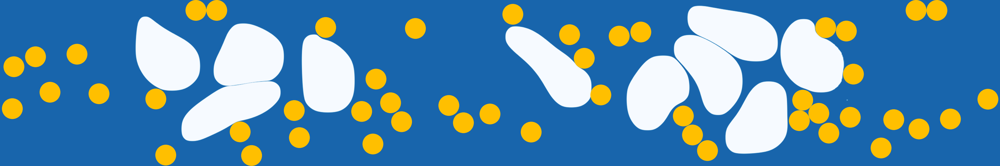

  

<h2>
  Skill
</h2>

  

    {{- range .Skills.Languages }}
    
    {{- end }}
  

  

    {{- range .Skills.Tools }}
    
    {{- end }}
  

  

<h2>
  Repositories
</h2>

{{- range .RepositoryTypes }}

<h3>
  {{ .Title }}
</h3>
{{- range .Items }}

  

{{- end }}
{{- end }}
